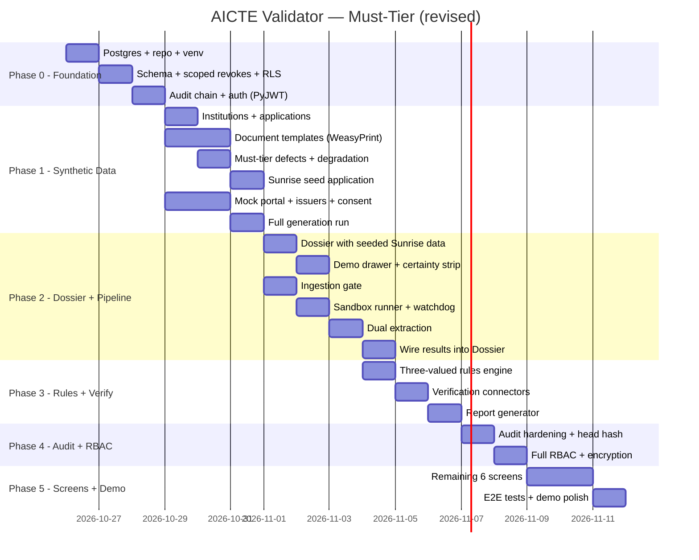

# AICTE Validation Prototype — Revised Build Plan (v2)

> **Everything runs on synthetic data, a simulated AICTE portal and simulated issuers.**

---

## Corrections Applied

| # | Issue | Fix |
|---|-------|-----|
| 1 | `REVOKE UPDATE, DELETE` on every table blocks state updates | Scoped to **audit_log, findings, document_status, verification_results, indicators** only. Other tables keep normal UPDATE. DELETE allowed on `file_keys` for crypto-shredding. |
| 2 | Sandbox profile used Docker paths and couldn't load Python | Tested profile uses real pyenv/homebrew paths. Validated: Python starts, network blocked, writes isolated. |
| 3 | `ulimit` memory caps not enforced on macOS | Added a **memory watchdog** thread that polls RSS and kills the child. CPU time + file size limits do work and are kept. |
| 4 | No `tmpfs` on macOS | Private temp dir `/private/tmp/aicte-sandbox-{uuid}/` with 0700, deleted after each job. |
| 5 | Vision models may fail inside deny-default sandbox (Metal blocked) | Vision runs on **CPU** inside sandbox. MPS used only in the main worker outside sandbox. |
| 6 | Stale versions, python-jose has security issues | **PyJWT** replaces python-jose. All versions pinned from PyPI at install time, not from memory. |
| 7 | Phase 1 builds Should-tier defects (D09, D14-D19) | Phase 1 builds **only Must-tier**: D01-D08, D10-D13, D20, D21. |
| 8 | UI comes last (days 14-16), classic demo miss | **Dossier built early** (Phase 2) with seeded "Sunrise" data, then wired to real results. |
| 9 | RLS not tested for forced non-owner roles | Explicit test: `ALTER TABLE ... FORCE ROW LEVEL SECURITY`, API connects as non-owner, cross-institution read must fail. |
| — | "arm64" | **Apple Silicon** throughout. |

---

## 0. Environment

### Current State (verified)
| Tool | Status |
|------|--------|
| macOS Apple Silicon (M1) | ✅ |
| Python 3.11.9 (pyenv) | ✅ (use 3.12 if installable, else 3.11 is fine) |
| Node.js 22.23.1 + npm 10.9.8 | ✅ |
| Homebrew 7.0.10 | ✅ |
| PostgreSQL 16 + pgvector | ❌ → install |
| sandbox-exec at `/usr/bin/sandbox-exec` | ✅ tested and working |
| Docker | ❌ not available, not needed |

### Install Script
```bash
# Postgres 16 + pgvector
brew install postgresql@16 pgvector
brew services start postgresql@16
echo 'export PATH="/opt/homebrew/opt/postgresql@16/bin:$PATH"' >> ~/.zshrc
source ~/.zshrc
createdb aicte_validator
psql aicte_validator -c "CREATE EXTENSION IF NOT EXISTS vector;"
psql aicte_validator -c "CREATE EXTENSION IF NOT EXISTS pgcrypto;"

# System deps for PDF/OCR
brew install poppler tesseract tesseract-lang ffmpeg

# Project venv (use 3.12 if available, else 3.11)
cd ~/Desktop/aicte
python3 -m venv .venv
source .venv/bin/activate

# Pin versions from PyPI at install time — do NOT use the stale table below
pip install --upgrade pip
pip install fastapi uvicorn pydantic sqlalchemy alembic  # exact versions pinned by pip freeze
```

> **Version pinning rule:** Run `pip install <package>` then `pip freeze > requirements/base.txt` to capture real versions. Never copy versions from memory.

---

## 1. Scoped Append-Only Tables (correction #1)

### Tables that are INSERT-only (REVOKE UPDATE, DELETE for every role):
- `audit_log` — hash chain integrity
- `findings` — only `app_det` can INSERT
- `document_status` — only `app_det` can INSERT  
- `verification_results` — only `app_det` can INSERT
- `indicators` — only `app_model` can INSERT
- `risk_scores` — only `app_model` can INSERT

### Tables that allow normal UPDATE (state machines):
- `applications` — stage transitions
- `review_items` — assignment, state changes
- `reviewer_actions` — not append-only, but audited
- `alerts` — acknowledged_by, delivered_at
- `information_requests` — state transitions (open → answered → closed → overdue)
- `system_mode` — mode changes
- `pipeline_jobs` — status, started_at, completed_at
- `documents` — type_detected updated after classification
- `consent_artifacts` — revocation

### Tables that allow DELETE:
- `file_keys` — crypto-shredding (retention job deletes key row, then file)

### Authority rule enforcement unchanged:
```
findings, document_status, verification_results → INSERT only by app_det
indicators, risk_scores                         → INSERT only by app_model  
sealed.* tables                                 → readable only by app_monitor
```

---

## 2. Sandbox Profile (tested on this machine)

### Validated Profile
```scheme
;; File: services/sandbox/deny_network.sb
;; Tested on macOS Apple Silicon — Python starts, network blocked, writes isolated
(version 1)
(deny default)

;; Process execution and forking
(allow process*)

;; File reads: interpreter, libraries, system frameworks, model weights
(allow file-read*)

;; File writes: ONLY to the per-job temp directory (parameterised at runtime)
;; The runner generates the profile with the real path substituted
(allow file-write*
  (subpath "/private/tmp/aicte-sandbox-JOBID")
  (subpath "/dev")
  (subpath "/private/var/folders")
)

;; IPC and system calls Python needs
(allow mach*)
(allow ipc*)
(allow sysctl*)
(allow signal)
(allow iokit*)
(allow system*)
(allow pseudo-tty)

;; Network: DENIED
(deny network*)
```

### Test Results (from this machine)
```
1. Write/read: PASS
2. Network: BLOCKED (GOOD)
3. Write isolation: PASS (can't write outside job temp dir)
4. Python version: 3.11
ALL SANDBOX SECURITY TESTS PASSED
```

### Sandbox Runner Design
```python
class SandboxRunner(Protocol):
    def run(self, input_path: Path, output_path: Path, 
            script: str, timeout_s: int = 120,
            memory_mb: int = 1024) -> SandboxResult: ...

class MacOSSandboxRunner:
    """
    1. Create /private/tmp/aicte-sandbox-{uuid}/ with 0700 permissions
    2. Copy decrypted input file into it
    3. Generate sandbox profile with real JOBID path
    4. Start subprocess under sandbox-exec
    5. Start memory watchdog thread (polls RSS every 2s, kills if > limit)
    6. Set RLIMIT_CPU (120s) and RLIMIT_FSIZE (256MB) via resource module
    7. Wait for completion or timeout
    8. Validate result.json against Pydantic schema
    9. Delete temp directory and all contents
    
    Labels on screen and in report: "OS-level sandbox, reduced isolation"
    """
```

### Memory Watchdog (correction #3)
```python
import psutil, threading, os, signal

class MemoryWatchdog:
    """Polls child process RSS every 2 seconds.
    Kills the process if RSS exceeds the configured limit.
    Needed because RLIMIT_RSS is not enforced on macOS."""
    
    def __init__(self, pid: int, limit_mb: int = 1024, poll_interval: float = 2.0):
        self.pid = pid
        self.limit_bytes = limit_mb * 1024 * 1024
        self.poll_interval = poll_interval
        self._stop = threading.Event()
    
    def start(self):
        self._thread = threading.Thread(target=self._poll, daemon=True)
        self._thread.start()
    
    def stop(self):
        self._stop.set()
    
    def _poll(self):
        while not self._stop.is_set():
            try:
                proc = psutil.Process(self.pid)
                rss = proc.memory_info().rss
                if rss > self.limit_bytes:
                    os.kill(self.pid, signal.SIGKILL)
                    return
            except (psutil.NoSuchProcess, ProcessLookupError):
                return
            self._stop.wait(self.poll_interval)
```

### Temp Directory (correction #4)
```python
import uuid, os, shutil

def create_job_temp() -> Path:
    """Create a private temp directory for one sandbox job.
    No tmpfs on macOS; use /private/tmp with restrictive permissions."""
    job_id = uuid.uuid4().hex
    path = Path(f"/private/tmp/aicte-sandbox-{job_id}")
    path.mkdir(mode=0o700)
    return path

def cleanup_job_temp(path: Path):
    """Delete the temp directory and all contents after the job."""
    shutil.rmtree(path, ignore_errors=True)
```

### Vision on CPU (correction #5)
```python
# Inside run_vision.py (runs inside sandbox)
import torch
# Force CPU — Metal/GPU requires IOKit GPU access that the sandbox blocks
device = torch.device("cpu")

# MPS is used only in the main worker process OUTSIDE the sandbox
# for any inference that doesn't need isolation
```

---

## 3. Row-Level Security (correction #9)

### Forced RLS
```sql
-- Every table with RLS gets FORCE
ALTER TABLE applications ENABLE ROW LEVEL SECURITY;
ALTER TABLE applications FORCE ROW LEVEL SECURITY;  -- applies even to table owner

-- The API connects as app_api, NOT the table owner
-- This is critical: RLS is bypassed for table owners unless FORCE is set
```

### Explicit Test
```python
def test_rls_enforced_for_api_role(db_connection):
    """API role (non-owner) cannot read another institution's data."""
    # 1. Insert application for institution A as migrator
    # 2. Connect as app_api with app.institution_id = B
    # 3. SELECT from applications → must return 0 rows
    # 4. INSERT into applications with institution_id = A → must fail

def test_rls_forced_even_for_owner(db_connection):
    """Even the table owner is subject to RLS when FORCE is set."""
    # Connect as the role that owns the table
    # SET app.institution_id to something
    # Must still be filtered
```

---

## 4. Build Phases — Revised Order

### Phase 0: Foundation (M0) — ~2 days

> **Done means:** Processes start; BOLA matrix passes; model-role INSERT into findings fails; audit verifier passes on a 100-entry chain.

| Step | Task | Tests |
|------|------|-------|
| 0.1 | Install Postgres 16 + pgvector, set up repo + venv | `psql` works, `CREATE EXTENSION vector` succeeds |
| 0.2 | Alembic migration: all core tables + scoped revokes + forced RLS | Roles exist; `app_model` INSERT into `findings` fails; `app_det` INSERT into `indicators` fails; UPDATE on `audit_log` fails for everyone; UPDATE on `applications.stage` succeeds for `app_api` |
| 0.3 | Audit chain: `audit_append()` SECURITY DEFINER function + `verify_chain.py` | Insert 100 entries → chain passes; tamper one → fails |
| 0.4 | Auth: argon2id + PyJWT (not python-jose) + rate limiting + lockout | Login works; expired token rejected; 6th bad attempt locked |
| 0.5 | FastAPI shell: health, CORS/CSP, Postgres job queue (`SKIP LOCKED`) | Health returns 200; job enqueue/dequeue works |
| 0.6 | `Procfile` for honcho (api, worker, mock_portal, mock_issuers) | `honcho start` launches all |

### Phase 1: Synthetic Data + Mock Services (M1) — ~4 days (was 3, realistic now)

> **Done means:** 1,400+ applications generated (Must-tier defects only); every issuer answers signed JWS; chaos switch works; Sunrise Institute seeded and ready for the early Dossier.

| Step | Task | Notes |
|------|------|-------|
| 1.1 | Institution generator (~300, Faker en_IN) | — |
| 1.2 | Application generator: dev (400), calibration (600), test (400), canary pool (300) | Different seeds per split |
| 1.3 | **Must-tier defects ONLY**: D01-D08, D10-D13, D20, D21 | D09, D14-D19 are Should-tier, built later |
| 1.4 | Document templates (WeasyPrint): ~10 types with field schemas, issuer profiles, QR codes | Each is HTML+CSS |
| 1.5 | PDF signing with mock CA (pyHanko) | Generate trust root + issuer certs |
| 1.6 | Degradation levels (Augraphy): L0-L3 | Applied at generation time |
| 1.7 | **"Sunrise Institute" seed application** with 2-3 known defects | Used for early Dossier and demo beat 1 |
| 1.8 | Mock AICTE portal (FastAPI, all record types, export openapi.json) | Integration contract |
| 1.9 | Mock issuers + consent server (OAuth2 + PKCE, chaos switch, JWS ES256) | Per-issuer chaos |

### Phase 2: Dossier + Upload Gate + Sandbox + Extraction (M2 + early M12) — ~4 days

> **Done means:** Dossier screen renders with seeded Sunrise data; malformed PDF contained; extraction accuracy per script/level produced.

| Step | Task | Notes |
|------|------|-------|
| **2.1** | **Dossier screen (early UI, correction #8):** React + Vite + TS + Tailwind, Application Detail with PDF viewer (react-pdf), bounding-box overlays, finding cards (static data from Sunrise seed) | Build the core review screen FIRST with seeded JSON, before real pipeline results exist |
| **2.2** | **Demo drawer:** chaos switch toggle, role switcher dropdown, database reset button. Cheap, built alongside the shell. | Always visible in demo mode |
| **2.3** | **Certainty strip:** per-field confidence indicator on the document overlay (green/amber/red/grey for TRUE/FALSE/UNKNOWN/no-data) | Wired to extraction confidence later |
| 2.4 | Ingestion gate: magic bytes, size/page limits, decompression ratio, encrypted PDF → UNREADABLE | UUID names, AES-256-GCM, hash, audit |
| 2.5 | Sandbox runner (macOS): profile from §2, memory watchdog, temp dir lifecycle, RLIMIT_CPU + RLIMIT_FSIZE | Vision on CPU inside sandbox |
| 2.6 | `run_doc.py`: render pages → PNG, text spans, pikepdf structure, pyHanko signatures, QR decode, dual OCR, page hashes | Runs inside sandbox-exec |
| 2.7 | `run_vision.py`: DINOv2 CLS embeddings (CPU), OWLv2 detections (CPU), EXIF | Runs inside sandbox, CPU only |
| 2.8 | Dual extraction: source decision, born-digital (pdfplumber + PyMuPDF) vs scanned (PaddleOCR + Tesseract), agreement logic, field parsing, validators | UNKNOWN on disagreement |
| 2.9 | Wire real extraction results into the Dossier | Bounding boxes, confidence, certainty strip goes live |

### Phase 3: Rules + Verification + Reports (M3 + M4) — ~3 days

> **Done means:** Three-valued logic passes (including Hypothesis property tests); all six verification statuses reachable; consent flow with PKCE works; report generates as JSON + PDF.

| Step | Task | Tests |
|------|------|-------|
| 3.1 | Three-valued rules engine: Kleene logic, closed operator set, UNKNOWN propagation, field dependency lineage | Hypothesis property tests for three-valued logic |
| 3.2 | Rule YAML loading, versioning (draft → approve → effective_from), placeholder gate | Rule with placeholder clause_ref cannot be approved |
| 3.3 | Handbook register (register.yaml, human-owned, fail-closed guards) | Engine refuses startup if active rule has bad clause_ref |
| 3.4 | Ship ~10-15 rules with verified clause refs for demo; rest return UNKNOWN ("norm not configured") | PLACEHOLDER badge visible in UI |
| 3.5 | What-if simulator: replay candidate rules over frozen applications, list flips | — |
| 3.6 | Verification connectors: 4 routes (signature, QR, reference lookup, consented fetch) | All 6 statuses reachable; replayed response rejected; PKCE works |
| 3.7 | Verification status machine with retry schedule | Retry at 1, 4, 15 min then daily |
| 3.8 | Verification debt calculation | — |
| 3.9 | Report generator: JSON (Pydantic, versioned) + PDF (WeasyPrint) | Report hash to audit chain |
| 3.10 | Wire findings, verification results and report into Dossier | Real data replaces seeded data |

### Phase 4: Audit Hardening + Full RBAC (M8) — ~2 days

> **Done means:** Both audit tests pass; retention purge shreds a key; masked PII in UI and logs; chain verifier button works in auditor view.

| Step | Task |
|------|------|
| 4.1 | Complete audit event coverage (every PS-named item) |
| 4.2 | `test_audit_covers_ps_events`: scripted application → each event produces audit entry |
| 4.3 | External head hash: daily to `data/mail/head_hash_{date}.json` + dashboard footer |
| 4.4 | Audit tests: (1) tamper → verifier fails; (2) recompute chain → internal passes, published head fails |
| 4.5 | RBAC: server-side check on every route + Postgres RLS (forced, non-owner API role) |
| 4.6 | PAN masking (last 4), permissioned reveal (audit-logged), no document content in logs |
| 4.7 | Encryption + retention: AES-256-GCM, crypto-shred via `file_keys` DELETE |
| 4.8 | Authorization matrix test (schemathesis), CSP, CORS, secure cookies |

### Phase 5: Remaining Screens + Demo Polish (M12 + M14) — ~2 days

> **Done means:** Playwright e2e covers the demo path; alert latency measured; 4-beat demo works end to end.

| Step | Task |
|------|------|
| 5.1 | Screen 1: Application list with status chips, filters, sort |
| 5.2 | Screen 3: Review queue by level (0-3), assignment |
| 5.3 | Screen 4: Alerts (SSE + list, PS alert types) |
| 5.4 | Screen 5: Auditor view (chain verifier, head-hash history, system mode) |
| 5.5 | Screen 6: Rules admin (editor, what-if, register viewer with PLACEHOLDER badges) |
| 5.6 | Screen 7: Institution portal (deficiencies Tier 1/2 only, rectification, evidence capture, consent) |
| 5.7 | Playwright e2e: login → upload → findings → accept/dismiss → report |
| 5.8 | Pre-seeded database snapshot for demo fallback |

> [!NOTE]
> Screen 2 (Dossier / Application Detail) is already built in Phase 2 and wired to real data in Phase 3.

---

## 5. Demo Script (4 beats, ~5 minutes)

### Beat 1: "Unknown is not False"
1. Submit "Sunrise Institute" application
2. Open demo drawer → flip chaos switch → issuer returns 503
3. Status becomes `SOURCE_UNAVAILABLE`, verification debt rises in the meter
4. **Nothing is rejected** — certainty strip shows grey (UNKNOWN)
5. Show a rule with unconfigured handbook norm → returns UNKNOWN ("norm not configured") with PLACEHOLDER badge

### Beat 2: Evidence-Linked Finding
1. Affidavit date conflicts with stamp-paper date
2. Both bounding boxes highlighted in PDF viewer (coloured by tier)
3. Recheck recipe displayed
4. Officer accepts/dismisses with a reason
5. Diagnosis panel names the one document to verify first

### Beat 3: Cross-Checks — **fallback plan**
- **If Splink (M6) is ready:** Live Splink indicator at Level 2 with per-field match weights
- **If not:** Pre-recorded video of the Splink demo, or static seeded data showing the match-weight panel with a "simulated" badge
- Either way, the Dossier shows the cross-check panel structure

### Beat 4: Measured Error + Audit — **fallback plan**
- **If canary monitor (M10) is ready:** Live drift replay → recall bound falls → DEGRADED
- **If not:** Auditor view shows the chain verifier working: edit audit row → verifier fails → recompute chain → published head catches it. Skip the canary chart or show a static chart with "simulated" label.

### Fallbacks (always ready)
- Pre-seeded database snapshot (`scripts/seed_demo.py`)
- Recorded video of full run
- Everything local, no network needed

---

## 6. Demo Drawer + Certainty Strip (correction #8)

### Demo Drawer (slide-out panel, always available in demo mode)

| Control | What it does |
|---------|-------------|
| **Chaos switch** | Toggles per-issuer chaos on mock issuers (503, latency, stale data) |
| **Role switcher** | Switch between institution_user, scrutiny_officer, supervisor, auditor, rules_admin, sysadmin |
| **Reset database** | Reloads the seeded snapshot (Sunrise + pre-computed results) |
| **System mode toggle** | Switch NORMAL / DEGRADED to show queue widening |
| **"All synthetic data" banner** | Always visible, not dismissable |

### Certainty Strip (per-field indicator on document overlay)

```
┌──────────────────────────────────────────┐
│ Institution Name  ████████ TRUE   ✓      │
│ Affidavit Date    ████████ FALSE  ✗ ←──── highlighted, recheck recipe
│ Stamp Paper Date  ████████ TRUE   ✓      │
│ PAN Number        ░░░░░░░░ UNKNOWN ?  ←── grey, "source unavailable"
│ Signature         ████████ TRUE   ✓      │
└──────────────────────────────────────────┘
```
- Green = TRUE (verified or rule passed)
- Red = FALSE (deficiency)  
- Amber = needs attention (MANUAL_REVIEW_REQUIRED)
- Grey = UNKNOWN (source unavailable, extraction disagreement, norm not configured)

---

## 7. Must-Tier Defects Only in Phase 1 (correction #7)

### Phase 1 (Must-tier)
| ID | Defect | Detector |
|----|--------|----------|
| D01 | Missing required document | Checklist rule, Tier 1 |
| D02 | Missing field | Extraction + rule, Tier 1 |
| D03 | Expired document | Rule, Tier 1 |
| D04 | Date inconsistency | Cross-doc rule, Tier 1 |
| D05 | Identifier checksum failure | Validator, Tier 1 |
| D06 | Cross-document name mismatch | Consistency rule, Tier 1 |
| D07 | Intake mismatch vs portal | Record comparison, Tier 1 |
| D08 | Reused document (hash) | SHA-256 duplicate, Tier 1 |
| D10 | Signature modified after signing | pyHanko, Tier 2 |
| D11 | Unsigned where required | Rule + pyHanko, Tier 2 |
| D12 | Issuer mismatch | Verification, Tier 2 |
| D13 | Source outage | Status SOURCE_UNAVAILABLE |
| D20 | Unreadable scan | Extraction disagreement, UNKNOWN |
| D21 | Injected instructions | Authority rule (no effect) |

### Deferred to Should-tier
| ID | Defect | Why deferred |
|----|--------|-------------|
| D09 | Edited text in PDF | PDF forensics, Tier 3 — needs pikepdf deep analysis |
| D14 | Same faculty at two institutions | Splink, Tier 3 — M6 |
| D15 | Shared address | Splink, Tier 3 — M6 |
| D16 | Reused lab photo | DINOv2 embeddings, Tier 3 — M5 |
| D17 | Floor-plan area below threshold | Geometry rule, Tier 1 but needs infrastructure module — M11 |
| D18 | Photo equipment count low | OWLv2 detector, Tier 3 — M11 |
| D19 | Photo challenge code missing | Challenge-response — M11 |
| D22-D25 | Held-out (test only) | Never used in tuning |

---

## 8. Dependency Management (correction #6)

### Rules
1. **Pin from PyPI at install time**, not from the plan's memory
2. `pip install <package>` → `pip freeze > requirements/<file>.txt` after each batch
3. **PyJWT** replaces python-jose (security issues, low maintenance)
4. Read each library's README before depending on it
5. Verify Splink 4, pyHanko, PaddleOCR, OWLv2 APIs against current docs

### Key replacements
| Was | Now | Reason |
|-----|-----|--------|
| python-jose | **PyJWT** | python-jose has had security issues and little maintenance |
| redis + rq | **Postgres SKIP LOCKED** | No Redis needed |
| Mailpit | **File-based** in `data/mail/` | No Docker |

### Install-time approach
```bash
# In venv, install and immediately freeze
pip install fastapi uvicorn pydantic sqlalchemy alembic \
    PyJWT argon2-cffi slowapi psutil \
    pymupdf pdfplumber pikepdf pyhanko \
    rapidfuzz unidecode weasyprint qrcode \
    faker augraphy cryptography shapely \
    numpy scipy statsmodels scikit-learn \
    pytest hypothesis

pip freeze > requirements/base.txt  # This is the real version pin
```

---

## 9. Revised Critical Path



**Total estimated: ~17 working days** for the Must-tier demo path. This is back-to-back without slack. Realistic calendar time depends on your availability.

> [!WARNING]
> Phase 1 (synthetic data + templates + signing + mock services) is the highest-risk phase for time overruns. Template-by-template PDF generation with signing, QR, and degradation is fiddly work. Budget 4 days, not 3.

---

## 10. Should-Tier Milestones (after Must path works)

| M | Deliverable | Adds |
|---|------------|------|
| M5 | Tier 1 & 3 detectors, isotonic calibration | D09, D16, reliability diagrams |
| M6 | Splink cross-institution linking | D14, D15, false-link rate |
| M7 | Diagnosis, verification planning, rectification diff | Hitting-set analysis |
| M9 | Classifier (TF-IDF baseline), risk model, conformal routing | Level 0-3 routing |
| M10 | Canaries, monitor, CUSUM, auto-degrade | Drift replay demo |
| M11 | Infrastructure module | D17, D18, D19, floor-plan geometry |
| M13 | Full evaluation + ablation + adversarial set | All PS metrics |
| M14 | Demo hardening | Two clean rehearsals |

### Stretch-Tier
| M | Deliverable |
|---|------------|
| M15 | Consequence corroboration (D26-D29, negative controls) |
| M16 | Stability probe (metamorphic consistency) |

---

## 11. Key Tests That Must Pass Before Demo

| Test | What it proves |
|------|---------------|
| `test_authority_rule` | `app_model` INSERT into `findings` → fails; `app_det` INSERT into `indicators` → fails |
| `test_rls_cross_institution` | API role with institution A cannot read institution B's data |
| `test_rls_forced` | Even table owner is filtered when `FORCE ROW LEVEL SECURITY` is set |
| `test_audit_chain_integrity` | 100 entries → verify passes; tamper one → verify fails |
| `test_audit_chain_vs_published_head` | Recompute after tampering → internal passes, published head fails |
| `test_three_valued_logic` | Hypothesis property tests for Kleene logic (all_of, any_of, not with UNKNOWN) |
| `test_placeholder_blocks_approval` | Rule with `clause_ref = "<fill>"` cannot be approved |
| `test_sandbox_network_blocked` | Network call inside sandbox → fails |
| `test_sandbox_write_isolation` | Write outside job temp dir → fails |
| `test_sandbox_memory_watchdog` | Process exceeding memory limit → killed |
| `test_verification_all_statuses` | All 6 PS statuses reachable |
| `test_unknown_never_rejects` | Finding with result=UNKNOWN never produces a rejection |
| `test_bola_matrix` | Every cross-institution request fails |
| `test_audit_covers_ps_events` | Scripted application → each PS event produces an audit entry |
| `test_crypto_shred` | After `file_keys` DELETE, file is unrecoverable |

---

## 12. Human Hand-Off Checklist (unchanged)

> An agent must not fill any of these. Each stays PLACEHOLDER until a person fills it.

| Item | Where used | Gate |
|------|-----------|------|
| Clause reference for every rule | Rules, findings, reports | Rule cannot be approved |
| Application categories + per-category checklists | Checklist selection | Cannot be activated |
| Minimum room areas + equipment minimums | Infrastructure module | Rules stay inactive |
| Consequence ratios and tolerances | Section 12 | `corroborated_by` rules stay inactive |
| Validity periods + digital signature requirements | Rules, status machine | Expiry rules stay inactive |
| Name-match cut-offs, instability threshold, risk threshold | Calibrated on data | Calibration report required |
| Red manifest + held-out defect choices | Evaluation | Harness refuses without them |
| Manual baseline timings | Evaluation | — |

> [!IMPORTANT]
> The demo runs with PLACEHOLDER values. Every screen that uses one shows a visible **PLACEHOLDER** badge. The results slide states which values were placeholders.

---

## 13. Immediate Execution Plan

After you approve, I build in this exact order:

1. **Install Postgres 16 + pgvector** (brew)
2. **Initialize repo:** pyproject.toml, folder structure, SPEC.md, CLAUDE.md, .gitignore
3. **Create database schema** with scoped revokes, forced RLS, 6 roles
4. **Audit chain** function + verifier
5. **Auth** with PyJWT + argon2id
6. **FastAPI shell** with Postgres job queue
7. **Synthetic generator** (institutions, applications, Must-tier defects)
8. **Document templates** (WeasyPrint, 10 types)
9. **Sunrise seed** application with known defects
10. **Dossier screen** (React, seeded data) ← early UI
11. **Demo drawer + certainty strip** ← cheap, done with Dossier
12. Continue through Phases 2-5 sequentially
